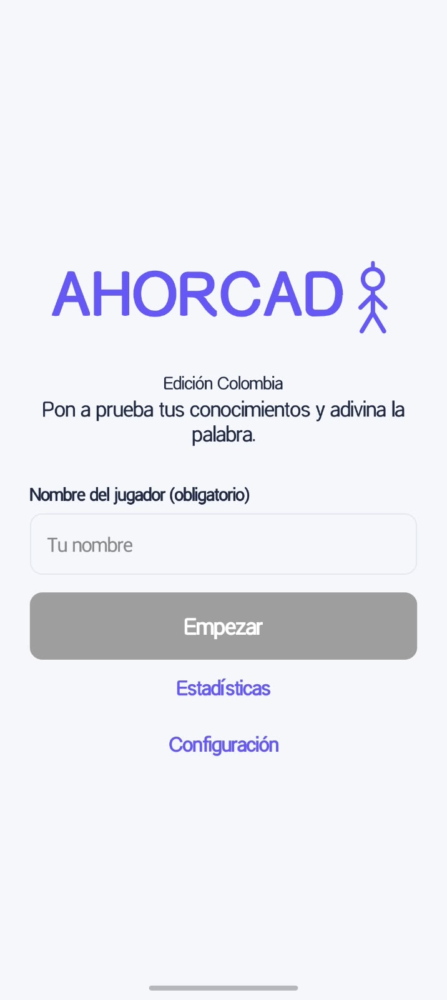
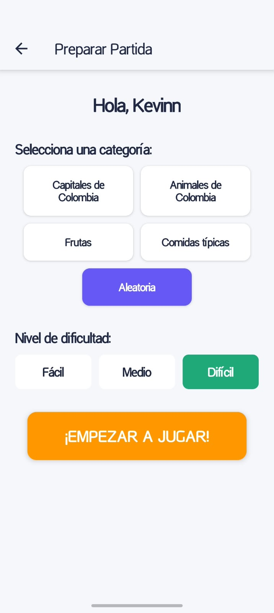
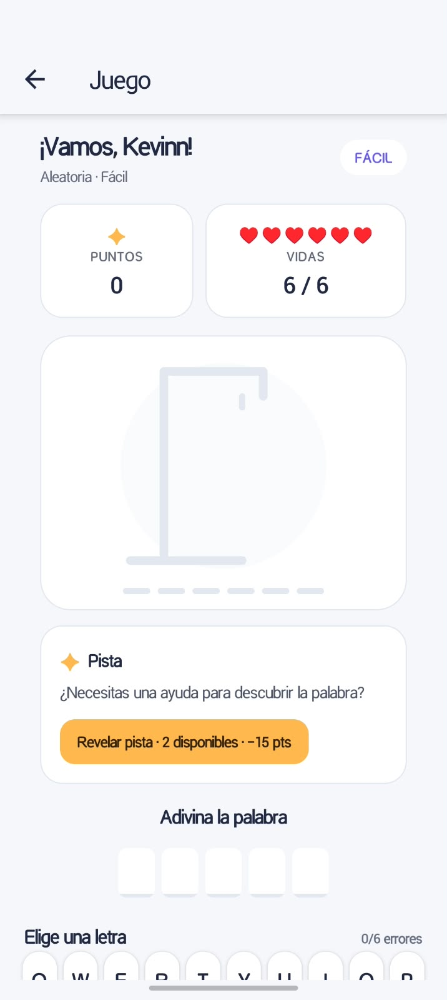
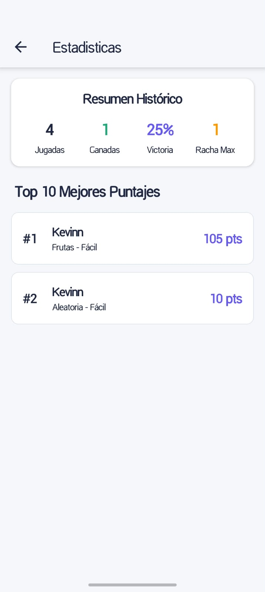
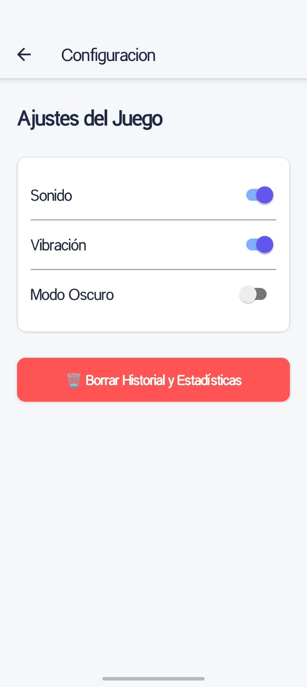

# 🇨🇴 Ahorcado — Edición Colombia

Aplicación móvil desarrollada como proyecto universitario de Ingeniería de Sistemas. El clásico juego del ahorcado se adapta a una experiencia interactiva con palabras y categorías relacionadas con Colombia, selección de dificultad, pistas, puntajes y estadísticas guardadas en el dispositivo.

## Capturas de pantalla


| Inicio | Selección de categoría | Partida |
| --- | --- | --- |
|  |  |  |

| Estadísticas | Configuración |
| --- | --- |
|  |  |

## Características principales

- Pantalla de inicio con validación de nombre obligatorio y título animado.
- Navegación entre Inicio, Categorías, Juego, Estadísticas y Configuración.
- Partidas de ahorcado con teclado virtual, niveles de dificultad y categorías.
- Sistema de pistas que descuenta 15 puntos del puntaje actual.
- Música ambiental en bucle que puede controlarse desde la configuración.
- Retroalimentación háptica al seleccionar letras.
- Tema claro y oscuro.
- Registro local de puntajes, partidas ganadas y perdidas, y rachas.
- Modal de resultado con opciones para volver a jugar o regresar al inicio.
- Interfaz adaptable a pantallas móviles y áreas seguras del dispositivo.

## Tecnologías y librerías

- **React Native** y **Expo SDK 57** para la aplicación móvil.
- **React Navigation 7** para la navegación entre pantallas.
- **AsyncStorage** (`@react-native-async-storage/async-storage`) para persistencia local.
- **expo-audio** para reproducir música de fondo.
- **expo-haptics** para la respuesta háptica.
- **react-native-svg** para gráficos vectoriales, incluido el ahorcado.
- **Animated** de React Native para animaciones de interfaz.
- **expo-asset** para el manejo de recursos estáticos.
- **EAS Build** para compilar la aplicación Android.

> **Nota sobre audio:** el proyecto usa actualmente `expo-audio`. `expo-av` fue retirado porque está obsoleto y ya no se importa en el código. No lo agregues de nuevo al instalar dependencias; `npm install` instala las versiones declaradas en `package.json` y `package-lock.json`.

## Requisitos

- Node.js y npm instalados.
- Git para clonar el repositorio.
- Expo Go en un dispositivo compatible, o un emulador Android/iOS.
- Una cuenta de Expo para generar compilaciones con EAS Build.

## Instalación y ejecución local

1. Clona el repositorio:

   ```bash
   git clone <URL_DEL_REPOSITORIO>
   ```

2. Entra a la carpeta del proyecto:

   ```bash
   cd ahorcado-app
   ```

3. Instala las dependencias:

   ```bash
   npm install
   ```

   El manifiesto incluye, entre otras, `expo-asset`, `expo-audio`, `expo-haptics`, `react-native-svg` y AsyncStorage. La música se implementa con `expo-audio`; no instales `expo-av`.

4. Inicia el servidor de desarrollo:

   ```bash
   npx expo start
   ```

5. Abre la aplicación con Expo Go escaneando el código QR, o selecciona un emulador disponible en la terminal.

## Generar un APK con EAS Build

El archivo `eas.json` incluye el perfil `preview` configurado para generar un APK Android de distribución interna. Desde la raíz del proyecto:

1. Inicia sesión en Expo si aún no lo has hecho:

   ```bash
   eas login
   ```

2. Ejecuta la compilación:

   ```bash
   eas build -p android --profile preview
   ```

El proyecto requiere `eas.json` con un perfil de compilación. Al finalizar, EAS Build proporciona un enlace para descargar el APK. La primera compilación puede solicitar que se configure el proyecto o las credenciales de Android.

## Estructura general

```text
ahorcado-app/
├── assets/                 # Imágenes, fuentes y audio
├── src/
│   ├── components/         # Componentes reutilizables de la interfaz
│   ├── context/            # Contexto del tema y preferencias
│   ├── data/               # Palabras y categorías
│   ├── hooks/              # Lógica reutilizable del juego
│   ├── navigation/         # Navegación de la aplicación
│   ├── screens/            # Pantallas
│   ├── storage/            # Persistencia local con AsyncStorage
│   └── theme/              # Colores y tema visual
├── app.json
├── eas.json
└── package.json
```

## Autor

**Kevinn Hernandez**  
Estudiante de Ingeniería de Sistemas  
Uniciencia — Bucaramanga, Colombia
